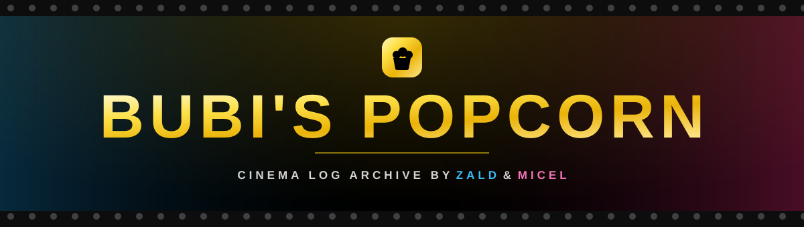
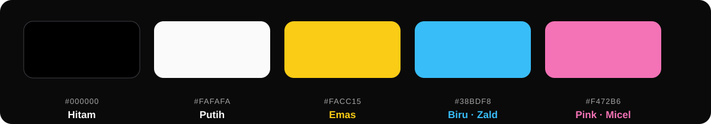
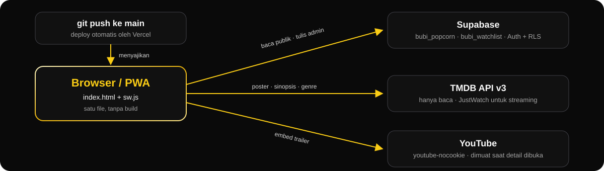

<div align="center">



<br>

**Buku harian film untuk berdua.**
<br>
<sub>Judul, rating, ulasan, dan momen nonton bareng, tersimpan rapi dan indah.</sub>

<br><br>

[](https://bubi-popcorn.vercel.app)
[](#mulai-cepat)
[](#mode-admin)
[](#lisensi-dan-kredit)
[](LICENSE)

<sub>[Fitur](#fitur) · [Desain](#desain) · [Arsitektur](#arsitektur) · [Mulai Cepat](#mulai-cepat) · [Setup](#setup) · [Mode Admin](#mode-admin) · [Skema Data](#skema-data) · [Lisensi](#lisensi-dan-kredit)</sub>

</div>


## Sekilas

Aplikasi web **mobile-first** untuk mengarsipkan film yang ditonton bersama oleh **Zald** dan **Micel**, lengkap dengan hitungan hari bersama dan jam dua zona waktu. Dirancang untuk iPhone: tab bar kaca, bottom sheet yang bisa digeser, dan tipografi yang nyaman dibaca.

| 📱 Mobile-first | 🗂 Satu file | ⚡ Tanpa build |
|:---:|:---:|:---:|
| Kolom tunggal `max-w-md`, target sentuh 44 px | Semua ada di [`index.html`](index.html) | HTML, CSS, JS murni via CDN |


## Fitur

<table>
<tr>
<td width="50%" valign="top">

### 🎬 Arsip film

- Catat judul, tahun, poster, bulan nonton, serta rating dan ulasan **terpisah** untuk Zald dan Micel
- **Karusel per bulan:** geser ke samping untuk bulan dan kartu film
- **Nuansa iOS:** tab bar kaca yang mengecil saat scroll, bottom sheet yang bisa digeser, tarik-untuk-muat-ulang, geser baris antrean untuk hapus (admin), haptic, dan menu tekan-tahan pada kartu
- Filter `Semua` · `Nonton Bareng` · `Zald Picks` · `Micel Picks` · `Top 9+`
- Pencarian judul atau bulan, mendukung nama bulan Indonesia
- **Certified Fresh:** film favorit tampil dalam emas metalik

</td>
<td width="50%" valign="top">

### 💞 Bareng-bareng

- **Mau Ditonton:** antrean film, tombol "Sudah ditonton" langsung membuka form ulasan
- **Statistik Kita:** rata-rata rating, favorit berdua, selera paling beda, bulan tersibuk
- **Roulette Nobar:** pilih film acak untuk malam ini
- **Tahun dalam Film:** recap tahunan yang bisa dibagikan
- **Hari bersama** sejak 5 April 2025, jam Zald (`Asia/Colombo`) dan Micel (`Asia/Tokyo`), konverter waktu, hitungan ulang tahun

</td>
</tr>
<tr>
<td width="50%" valign="top">

### 🎞 Data dari TMDB

- Isi otomatis judul, tahun, dan poster di form
- Detail film: genre, durasi, rating, sinopsis, sutradara, pemeran, streaming di Indonesia
- **Trailer** langsung tampil di modal (tap play)
- Sinkron poster massal dengan pratinjau dan centang per film
- **Rekomendasi:** "Lanjut nonton" di detail (koleksi dan season) serta **Baru & Sudah Streaming** di Beranda; berganti tiap Senin

</td>
<td width="50%" valign="top">

### 🔐 Admin dan data

- Tambah, edit, hapus film di balik satu password
- **Ekspor CSV** untuk semua orang, **impor CSV** khusus admin (format sendiri atau diary Letterboxd)
- PWA: bisa dipasang ke layar utama dan jalan offline
- Indikator latensi ke Supabase

</td>
</tr>
</table>


## Desain

### Palet



Hitam dan putih sebagai dasar, **emas** sebagai aksen brand, **biru hanya untuk Zald** dan **pink hanya untuk Micel**. Merah hanya untuk hapus dan error. Semua teks diperiksa minimal kontras 4,5:1.

### Tipografi

Skala tunggal untuk iPhone di `tailwind.config`: `micro` 11 px (label), `caption` 12, `xs` 13, `sm` 15 (isi), `base` 16 (judul modal, input; mencegah zoom otomatis iOS), lalu skala bawaan Tailwind. Font: **Anton** (judul), **Outfit** (display), **Inter** (isi).

### Material dan gerak

| | |
|---|---|
| **Liquid Glass** | Tab bar kapsul melayang dan tombol header berbahan kaca buram, versi CSS yang jalan di Safari |
| **Emas metalik** | Film *Certified Fresh*: bingkai gradien, kilau yang menyapu pelan, lencana logam |
| **Bottom sheet** | Handle dan geser ke bawah untuk menutup modal |
| **Poster bertahap** | Versi kecil buram dulu, lalu poster tajam memudar masuk |
| **Gerak** | Menghormati `prefers-reduced-motion` dan `prefers-reduced-transparency` |
| **Aksesibilitas** | Elemen native, modal menahan fokus dan menutup dengan Escape, target sentuh min. 44×44 px |


## Arsitektur



## Mulai Cepat

Pakai server lokal (bukan `file://`), karena ada service worker:

```bash
python3 -m http.server 4173
```

Buka <http://localhost:4173>. Tidak ada langkah build atau dependensi untuk dipasang.

### Konfigurasi

Semua konstanta ada di bagian atas script `index.html`:

| Konstanta | Isi |
|---|---|
| `SUPABASE_URL` · `SUPABASE_KEY` | Proyek Supabase dan publishable key (aman untuk publik, asal RLS aktif) |
| `TABLE_NAME` | Tabel utama, `bubi_popcorn` |
| `ADMIN_EMAIL` | Email akun admin; UI hanya meminta password |
| `TMDB_API_KEY` | API Key v3, hanya-baca. Kosong = fitur TMDB nonaktif |

## Setup

<details>
<summary><b>Supabase</b>: RLS dan akun admin (sekali saja)</summary>

<br>

1. **Matikan pendaftaran publik:** Authentication → Sign In / Providers → Email → nonaktifkan *Allow new users to sign up*. Wajib, kalau tidak siapa pun bisa membuat akun dan mendapat izin tulis.
2. **Buat satu akun admin:** Authentication → Users → Add user.
   - Email harus sama persis dengan `ADMIN_EMAIL` di `index.html` (`admin@bubipopcorn.app`).
   - Password bebas, itu yang diketik di aplikasi.
   - Centang *Auto Confirm User*.
3. **Aktifkan RLS** di SQL Editor:

```sql
alter table public.bubi_popcorn enable row level security;

create policy "Public read" on public.bubi_popcorn
  for select using (true);
create policy "Admin insert" on public.bubi_popcorn
  for insert to authenticated with check (true);
create policy "Admin update" on public.bubi_popcorn
  for update to authenticated using (true) with check (true);
create policy "Admin delete" on public.bubi_popcorn
  for delete to authenticated using (true);
```

> [!IMPORTANT]
> Publishable key di `index.html` memang aman untuk publik, tetapi **tanpa RLS** siapa pun bisa menulis langsung ke tabel. RLS-lah yang menolak permintaan tulis dari pengunjung yang belum login. Tombol admin di UI hanya kenyamanan, bukan pengamanan.

</details>

<details>
<summary><b>Watchlist</b>: tabel Mau Ditonton</summary>

<br>

Jalankan [`supabase/watchlist.sql`](supabase/watchlist.sql) sekali di SQL Editor. Tabel `bubi_watchlist`: baca publik, tulis hanya admin. Tanpa tabel ini bagian "Mau Ditonton" tersembunyi dan fitur lain tetap normal.

</details>

<details>
<summary><b>TMDB</b>: API key</summary>

<br>

1. Daftar gratis di [themoviedb.org](https://www.themoviedb.org/signup), lalu Settings → API → buat aplikasi bertipe Developer.
2. Pakai **API Key (v3)**, string pendek 32 karakter. **Jangan** pakai *API Read Access Token* (v4) yang panjang berawalan `eyJ`.
3. Isi `const TMDB_API_KEY = '<api-key-v3>';` di `index.html`.

Key v3 hanya bisa membaca data publik dan memang terlihat di klien. Kalau bocor, buat ulang di halaman API TMDB lalu ganti nilainya. Dikosongkan = fitur TMDB nonaktif, form manual tetap jalan.

</details>

## Mode Admin

- Satu password bersama untuk Zald dan Micel. Email tetap di kode (`ADMIN_EMAIL`), jadi layar hanya meminta password.
- Password **tidak ada** di `index.html`. Diverifikasi di server lewat Supabase Auth (`signInWithPassword`).
- Sesi disimpan Supabase; klik gembok lagi untuk keluar. Ganti password kapan saja lewat dashboard tanpa deploy ulang.
- Setelah masuk muncul tombol tambah, edit dan hapus film, pengelolaan antrean, impor CSV, dan sinkron poster TMDB.

## Skema Data

**`bubi_popcorn`**: rating `*_aku` milik Zald, `*_dia` milik Micel.

| Kolom | Tipe | Keterangan |
|---|---|---|
| `id` | text | Primary key, `m_<timestamp>` |
| `judul` | text | Judul film |
| `tahun` | int | Tahun rilis |
| `poster` | text | URL poster (opsional) |
| `bulan` | text | Bulan menonton, `YYYY-MM` |
| `watched_by` | text | `both` \| `zald` \| `micel` |
| `is_certified` | bool | Penanda Certified Fresh |
| `rating_aku` / `rating_dia` | text | Rating 0–10 |
| `review_aku` / `review_dia` | text | Ulasan |

**Kolom opsional** (jalankan SQL-nya sekali di SQL Editor; tanpa kolom, fiturnya otomatis tersembunyi):

| SQL | Kolom | Fungsi |
|---|---|---|
| [`kutipan.sql`](supabase/kutipan.sql) | `kutipan` | Kutipan favorit per film |
| [`season.sql`](supabase/season.sql) | `season` | Season series, lencana "S2" di kartu dan detail |
| [`tmdb_id.sql`](supabase/tmdb_id.sql) | `tmdb_id`, `tmdb_media` | Pencocokan rekomendasi yang akurat; lengkapi film lama lewat sinkron TMDB (admin). Tanpa ini pencocokan memakai judul + tahun |

**`bubi_watchlist`**: `id` (`w_<timestamp>`), `judul`, `tahun`, `poster`, `created_at`. Skema lengkap di [`supabase/watchlist.sql`](supabase/watchlist.sql).

## Struktur Proyek

| Path | Fungsi |
|---|---|
| `index.html` | Seluruh aplikasi |
| `sw.js` | Service worker (network-first untuk HTML, cache-first untuk aset; Supabase dan TMDB tidak di-cache) |
| `manifest.json` | Metadata PWA |
| `assets/` | Gambar slider, foto profil, ikon PWA, logo TMDB, dan `readme/` (aset README) |
| `supabase/watchlist.sql` | Skema tabel watchlist |
| `supabase/kutipan.sql` | Kolom `kutipan` (kutipan favorit per film), opsional |
| `supabase/season.sql` | Kolom `season` (nomor season series), opsional |
| `supabase/tmdb_id.sql` | Kolom `tmdb_id` dan `tmdb_media` untuk pencocokan rekomendasi yang akurat, opsional |
| `DEBUG.md` · `AGENTS.md` | Guide debug dan konvensi kerja |
| `LICENSE` | MIT untuk kode |

## Deploy dan Pengembangan

- Push ke `main` otomatis dideploy ke Vercel. `push.bat` tersedia untuk Windows.
- Setelah mengubah `index.html` atau aset yang di-cache, naikkan `CACHE_NAME` di `sw.js`.
- Konvensi dan cara uji: [`AGENTS.md`](AGENTS.md). Peta kode dan resep debug: [`DEBUG.md`](DEBUG.md).

## Lisensi dan Kredit

- **Kode:** [MIT](LICENSE). Isi arsip pribadi (judul yang dicatat, rating, ulasan) dan foto di `assets/` tidak termasuk dan tetap hak pemiliknya.
- **TMDB:** This product uses TMDB and the TMDB APIs but is not endorsed, certified, or otherwise approved by TMDB. Logo resmi dipakai apa adanya di footer. Data streaming dari JustWatch lewat TMDB.
- **Poster, gambar, dan trailer** adalah hak cipta pemilik masing-masing, ditampilkan untuk arsip pribadi nonkomersial. Pemutar trailer tunduk pada Ketentuan Layanan YouTube.
- **Pustaka:** Tailwind CSS (MIT), Font Awesome Free (ikon CC BY 4.0, font SIL OFL 1.1, kode MIT), Google Fonts Anton, Inter, Outfit (SIL OFL 1.1), Supabase JS (MIT).

Daftar yang sama tampil di footer situs, bagian **Kredit & Lisensi**.


<div align="center">

**THE END**

<sub>Cinema log archive by <b>Zald</b> & <b>Micel</b> · © 2026 Bubi's Popcorn</sub>

</div>
